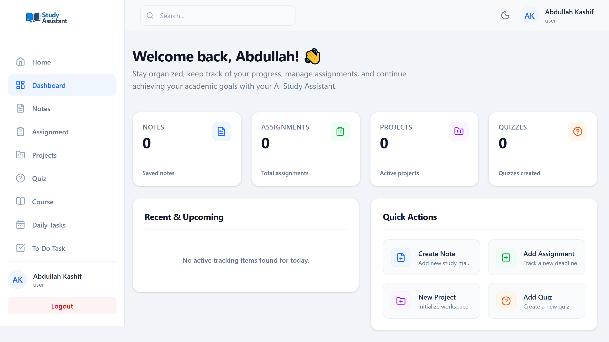

# AI Study Assistant


A full-stack study workspace that brings academic records, deadlines, tasks, and AI-assisted revision into one application. Built with the MERN stack, it combines seven study-management modules with document-grounded questions, note summaries, practice quizzes, and a read-only AI Study Planner.

The interface supports light and dark themes, responsive navigation, and shared record lists and forms across the study modules.

## Live demo and repository

| Resource | Link |
| --- | --- |
| Live application | [Open AI Study Assistant](https://study-assistant-mu-livid.vercel.app/) |
| Backend | [Render API service](https://ai-study-assistant-x2xs.onrender.com) |
| Source code | [AbdullahKashif804/study-assistant](https://github.com/AbdullahKashif804/study-assistant) |

**First visit:** the Render Free backend may take time to wake up after inactivity, so the first API request can be slower. See [Render Free service behavior](https://render.com/docs/free).

## Key features

### Study-management modules

| Module | Implemented functionality |
| --- | --- |
| **Notes** | Create, edit, and delete notes; organize by course; search, filter, sort, and paginate; attach study files; generate and revisit saved AI summaries and quizzes. |
| **Assignments** | Track course relationships, due dates, submission/grading status, total and obtained marks, descriptions, and attachments. |
| **Projects** | Manage course-linked projects, technologies, deadlines, progress/grading status, marks, and supporting attachments. |
| **Courses** | Manage course titles, codes, instructors, descriptions, semesters, status, and attachments. New courses default to the profile semester, with a per-course override. |
| **Quizzes** | Track academic quiz records, courses, deadlines, submission/grading status, and scores. These records are separate from AI-generated practice quizzes. |
| **Daily Tasks** | Organize dated tasks with descriptions, priorities, progress states, completion controls, and paginated results. |
| **To-Do Tasks** | Manage priorities, due dates, completion/progress states, overdue indicators, and paginated results. |

Each module retains its own fields and supported search/filter/sort controls. Notes, Daily Tasks, and To-Do Tasks use backend pagination; other modules display their available records and counts without unsupported page requests.

Changing the current semester in Profile affects the default for **new** courses. Existing courses retain their assigned semester, and editing a course starts with its stored value.

### Dashboard, account, and interface

- **Dashboard:** module statistics, task progress, recent notes, upcoming academic work, quick actions, and AI Study Planner access.
- **Global search:** owner-scoped search across the seven study modules.
- **Deadline reminders:** in-app reminders for assignments, projects, quizzes, and to-do tasks, with notification preferences.
- **Profile and Settings:** personal and academic details, current semester, profile image, theme preferences, password changes, and explicitly confirmed account deletion.
- **Admin dashboard:** role-protected aggregate statistics. The implemented admin API is a statistics interface, rather than a user-management CRUD system.
- **Responsive forms:** desktop list/form columns with independently scrolling long forms; centered tablet dialogs and full-screen mobile forms.
- **Draft protection:** retained values on form Close, discard prompts for supported actions, and unload/navigation guards where the browser supports them.

## AI-powered functionality

| Feature | How it works |
| --- | --- |
| **AI Summary** | Generates a summary, key points, and quick-revision material from a note. Saved results can be viewed again. |
| **AI Quiz** | Generates multiple-choice practice questions with answers and explanations from note content, and stores the result for later viewing. |
| **Ask Your Study Material** | Retrieves relevant passages from the user's notes and supported documents, then generates an answer with source information. |
| **AI Study Planner** | Uses read-only tools to inspect academic deadlines, tasks, and relevant study material, then suggests study priorities and next steps. It does not automatically create or modify records. |

**Retrieval pipeline:** note text and PDF/DOCX/PPTX extraction -> overlapping text chunks -> local transformer embeddings -> similarity retrieval scoped to the authenticated user -> Groq-generated answer.

Groq provides text generation using the configured `openai/gpt-oss-20b` model. Local embeddings use `Xenova/all-MiniLM-L6-v2` through Hugging Face Transformers.js. Source retrieval supports grounded answers, but AI output should still be reviewed for accuracy.

External AI calls have a 30-second timeout. Document processing, extracted text, retrieval chunks, context size, tool calls, and concurrent work are bounded. Documents processed by AI are limited to 10 MiB; additional text and workload limits are documented in the [AI guide](docs/AI.md). Authenticated Cloudinary documents are retrieved server-side for AI processing.

## Technologies used

| Layer | Technologies |
| --- | --- |
| Frontend | React 19, Vite 8, Tailwind CSS 4, React Router, Lucide React, native Fetch API |
| Content rendering | React Markdown, remark-gfm |
| Backend | Node.js, Express 5, Mongoose 9, native Fetch API |
| Database | MongoDB / MongoDB Atlas |
| Authentication | JSON Web Tokens, bcrypt, email verification OTPs |
| AI and retrieval | Groq API, Hugging Face Transformers.js, local embeddings, OfficeParser, worker-based document extraction |
| Uploads | Multer temporary uploads, Cloudinary storage and authenticated delivery |
| Email | Brevo transactional email HTTP API |
| Quality tools | Node.js test runner, Oxlint, Vite production build |
| Hosting | Vercel frontend, Render backend |

## Authentication and security

- Signup uses pending registration records and six-digit, expiring email OTPs; verification completes account creation. Resend verification is supported.
- Passwords are hashed with bcrypt cost 12. Verification remains compatible with existing lower-cost bcrypt hashes without forcing password resets.
- Protected APIs verify bearer JWTs and the current user record. User-owned records and course relationships are checked server-side; admin routes additionally require the admin role.
- Login, signup, OTP verification, and resend endpoints have in-memory rate limits. These limits are process-local and reset on restart; they are not shared across multiple server instances.
- Backend validation checks supported fields, numeric marks, and semester ranges. Upload restrictions and scoped temporary-file cleanup apply to upload processing.
- MongoDB must connect before the HTTP server starts accepting requests.
- Account deletion uses the authenticated identity, removes associated study records, and handles cloud cleanup through a recoverable deletion flow. MongoDB transactions cannot make Cloudinary operations atomic; failed cleanup can require retry/recovery.

### Attachment privacy

**New Notes, Assignments, Projects, and Courses attachments use Cloudinary authenticated delivery.** Preview/download requests pass through JWT-protected, owner-scoped backend endpoints. The backend retrieves and streams the asset without returning reusable signed Cloudinary URLs to the browser. Delivery uses bounded transfer size/time, controlled content headers, and private/no-store caching.

Replacement uploads and saves the new reference before attempting old-file cleanup. Metadata tracks the Cloudinary public ID, resource type, and delivery type so replacement, deletion, and account cleanup use the correct asset identifiers.

**Legacy public attachments remain publicly accessible through their original Cloudinary URLs until migrated.** Protecting an API endpoint does not revoke those URLs. Profile images intentionally retain their existing public delivery behavior. Previously downloaded files cannot be revoked.

See the [security and recovery guide](docs/SECURITY.md) and [Cloudinary migration guide](docs/CLOUDINARY.md) for limitations and recovery procedures. These controls are not a claim that all production security risks have been eliminated.

## Application architecture

```text
React client (Vercel / Vite development server)
    |
    | Fetch API + bearer JWT
    v
Express API (Render / local Node.js)
    |-- Authentication, ownership, validation, and workload middleware
    |-- Controllers and services --> MongoDB Atlas
    |-- Attachment streaming -----> Cloudinary
    |-- AI generation ------------> Groq
    |-- Document retrieval -------> extraction workers + local embeddings
    +-- Verification email -------> Brevo HTTP API
```

```text
study-assistant/
|-- backend/
|   |-- config/          # Database, Cloudinary, AI limits
|   |-- controllers/     # Authentication, CRUD, dashboard, AI
|   |-- middleware/      # JWT, validation, limits, uploads
|   |-- models/          # Users, pending signups, seven study modules
|   |-- routes/          # Express API routes
|   |-- services/        # AI, retrieval, embeddings, document processing
|   |-- utils/           # Email, uploads, delivery, cleanup helpers
|   |-- scripts/         # Isolated Cloudinary diagnostic
|   |-- tests/           # Automated backend suites
|   +-- server.js
|-- frontend/
|   |-- public/          # Static assets and dashboard screenshot
|   |-- src/
|   |   |-- components/  # Shared UI and module-specific components
|   |   |-- config/      # Shared API base URL
|   |   |-- context/     # Theme state
|   |   |-- hooks/       # Draft and responsive-dialog behavior
|   |   +-- pages/       # Auth, dashboard, CRUD, profile, settings, admin, legal
|   +-- tests/
|-- docs/                # Security, Cloudinary, AI, frontend guides
|-- PROJECT_AUDIT.md     # Historical technical audit and follow-up notes
+-- README.md
```

The API groups routes under `/api/user`, `/api/note`, `/api/assignment`, `/api/project`, `/api/quiz`, `/api/course`, `/api/dailyTask`, `/api/todoTask`, `/api/dashboard`, `/api/admin`, `/api/search`, and `/api/ai`.

## Installation and local setup

### Prerequisites

- Node.js compatible with the installed packages: `^20.19.0 || >=22.12.0` for Vite 8; Mongoose 9 also requires Node.js 20.19 or later.
- npm and Git.
- A MongoDB connection. Account-deletion transactions require a replica set or sharded deployment, such as MongoDB Atlas.
- Cloudinary, Groq, and Brevo configuration for attachments, AI, and verification email respectively.

### 1. Clone and install

```bash
git clone https://github.com/AbdullahKashif804/study-assistant.git
cd study-assistant
cd backend
npm ci
cd ../frontend
npm ci
```

### 2. Configure environment variables

Create local environment files in `backend/.env` and `frontend/.env.local` using the variable names below. Supply your own values; never commit credentials. No secret values or shared demo credentials are provided here.

### 3. Start the backend

From the repository root:

```bash
cd backend
npm run dev
```

The backend defaults to `http://localhost:5000` and only starts listening after MongoDB connects. Use `npm start` to run without Nodemon.

### 4. Start the frontend

In a second terminal, from the repository root:

```bash
cd frontend
npm run dev
```

Open the local address printed by Vite, normally `http://localhost:5173`. Signup requires working Brevo delivery and a configured sender. Local embedding model initialization can require an initial model download and additional startup time on first AI use.

## Environment variables

Variable **names and purposes only** are listed below. Backend credentials belong on the server; Vite variables are exposed to the browser bundle.

| Scope | Variable | Purpose |
| --- | --- | --- |
| Frontend | `VITE_API_BASE_URL` | Public backend origin; required for production. |
| Backend | `MONGODB_URL` | MongoDB connection string. |
| Backend | `JWT_SECRET` | JWT signing and verification secret. |
| Backend | `CLOUDINARY_CLOUD_NAME` | Cloudinary product environment identifier. |
| Backend | `CLOUDINARY_API_KEY` | Server-side Cloudinary API credential. |
| Backend | `CLOUDINARY_API_SECRET` | Server-side Cloudinary signing credential. |
| Backend | `GROQ_API_KEY` | Server-side Groq API credential. |
| Backend | `BREVO_API_KEY` | Brevo transactional email API credential. |
| Backend | `BREVO_SENDER_EMAIL` | Configured transactional email sender. |
| Backend | `BREVO_SENDER_NAME` | Optional sender display name. |
| Backend | `FRONTEND_URL` | Deployed frontend origin allowed by CORS. |
| Backend | `PORT` | HTTP port; hosting platforms can supply it. |
| Platform | `RENDER` | Render-provided marker used to enable trust for the nearest proxy hop. |

The shared frontend configuration in `frontend/src/config/api.js` trims whitespace and trailing slashes. It accepts an HTTP(S) **origin**, without credentials, API paths, queries, or fragments. Development falls back to the local backend when unset; production requires an explicit HTTPS origin and never silently falls back to localhost.

`VITE_API_BASE_URL` is substituted at build time: changing it requires rebuilding the frontend. It is not a place for tokens or server-side secrets.

## Deployment

| Service | Application directory | Build / start |
| --- | --- | --- |
| Vercel frontend | `frontend` | Build: `npm run build`; output: `dist`. |
| Render backend | `backend` | Install: `npm ci`; start: `npm start`. |
| MongoDB Atlas | External database | Provide the backend connection string and permit the deployment's network access. |

Configure the frontend API variable with the backend origin listed above. Configure the backend CORS variable with the exact frontend origin, without a trailing slash. Set server-side credentials through the hosting provider's environment settings.

The frontend uses browser-based routing, so the host must serve the SPA entry point for client-side routes on refresh. The backend's `GET /` endpoint returns a basic running response; it is not a complete dependency-readiness monitor.

Render Free cold starts, ephemeral local storage, and limited CPU/memory matter for uploads and local embedding initialization. Temporary uploads are processing files, not permanent storage; Cloudinary stores attachments. Verify proxy assumptions again if adding another CDN or reverse proxy.

## Testing and quality assurance

The repository includes Node.js test-runner suites for:

- MongoDB startup sequencing, password hashing compatibility, authentication rate limits, and input validation.
- Account deletion, attachment ownership/delivery, replacement compensation, and scoped temporary-file cleanup.
- AI timeouts and workload limits, plus Cloudinary diagnostic behavior.
- Frontend API configuration, authenticated attachment access, and shared UI/draft behavior.

From the repository root:

```bash
node --test backend/tests/*.test.js
node --test frontend/tests/*.test.mjs
```

From `frontend`:

```bash
npm run lint
npm run build
npm run preview
```

Lint uses **Oxlint**. The package scripts do not currently define `npm test`; use the explicit Node.js commands above. Most flow tests use mocked database, cloud, AI, and browser behavior; password tests use synthetic inputs. These suites do not establish live integration, accessibility, or device/browser compatibility on their own.

Historical execution results and the previously observed large-bundle warning are recorded in the technical documentation; they are not a claim that the current deployment has passed a new test run. Cloudinary's standalone live diagnostic is separate from mocked tests and must only be run deliberately with disposable assets and cleanup.

For release verification, manually exercise signup/email verification, login, each module's CRUD/search/filter behavior, semester defaults, uploads and owner-only downloads, AI generation/retrieval, draft prompts, and account-deletion recovery using isolated test accounts. Check desktop, tablet, and mobile widths in both themes.

## Screenshots

### Dashboard



This is the existing dashboard image included with the project. It illustrates the interface at the time of capture and may differ from the latest deployed UI; no additional screenshots are implied.

## Technical documentation

| Guide | Contents |
| --- | --- |
| [Security](docs/SECURITY.md) | Authentication safeguards, validation, deletion recovery, and remaining security considerations. |
| [Cloudinary](docs/CLOUDINARY.md) | Authenticated delivery, replacement safety, temporary cleanup, diagnostics, and legacy migration/recovery. |
| [AI](docs/AI.md) | Summary/quiz generation, RAG, Study Planner, and workload budgets. |
| [Frontend](docs/FRONTEND.md) | Shared UI layouts, semantic colors, responsive forms, draft protection, and browser checks. |
| [Project audit](PROJECT_AUDIT.md) | Historical findings and follow-up status; retain the distinction between dated observations and current code. |

Some historical deployment notes predate the current Brevo email integration and deployed CORS configuration. The environment-variable names and email transport in this README reflect the current implementation.

## Future improvements

These are follow-up opportunities, **not completed features**:

- Migrate legacy public study attachments with inventory, backup, verification, retry, and rollback safeguards.
- Share authentication rate-limit state across instances if scaling beyond a single backend process.
- Add broader live integration and automated browser/accessibility regression coverage, with CI checks.
- Reduce frontend bundle size through measured code splitting and lazy loading.
- Improve background document processing, model cold-start behavior, operational readiness checks, and cleanup observability.
- Explore calendar integration, additional notification channels, and progressive web app support.

## Author

**Abdullah Kashif**  
BS Artificial Intelligence student and MERN Stack developer.

[GitHub profile](https://github.com/AbdullahKashif804) | [Project repository](https://github.com/AbdullahKashif804/study-assistant)

Developed as an educational and portfolio project.
